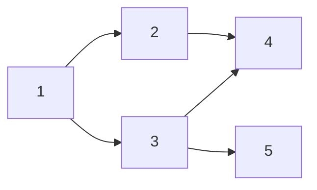

## 0. 한눈에 보기

JavaScript로 코딩 테스트를 볼 때 자주 쓰는 **문법, 자료구조, 알고리즘 템플릿, 함정** 을 정리했다.

| 구분              | 내용                                                                 |
| ----------------- | -------------------------------------------------------------------- |
| 1. 입출력         | 프로그래머스 / 백준(Node.js) 입력 받기, 빠른 출력                     |
| 2. 시간 복잡도    | 입력 크기로 허용되는 알고리즘 판단하기                               |
| 3. 배열           | 순회, map·filter·reduce, 정렬, 배열 생성, 자주 쓰는 메서드           |
| 4. 문자열         | split·join, 아스키코드, 문자열 함정                                  |
| 5. 숫자·수학      | 정수 나눗셈, 큰 수(BigInt), 진법 변환, GCD·LCM, 소수                 |
| 6. 자료구조       | 스택, 큐, Map·Set, 우선순위 큐(힙)                                   |
| 7. 알고리즘 템플릿 | DFS, BFS, 이분 탐색, 투 포인터, 누적합, DP, 다익스트라, 유니온 파인드, 순열·조합 |
| 8. 함정 모음      | JS로 코테 볼 때 자주 틀리는 부분                                      |

---

## 1. 입력과 출력

### 1.1 프로그래머스

함수의 매개변수로 입력이 주어지고, **`return`으로 답을 반환** 한다.

```js
function solution(numbers, target) {
  let answer = 0
  // ...
  return answer
}
```

### 1.2 백준 (Node.js)

백준은 **표준 입력(stdin)** 을 직접 읽어야 한다.

```js
// 전체 입력을 한 번에 읽어서 줄 단위로 나누기 (가장 많이 쓰는 방식)
const input = require('fs').readFileSync('/dev/stdin', 'utf8').trim().split('\n')

const n = Number(input[0])                      // 첫 줄 : 숫자 하나
const arr = input[1].split(' ').map(Number)      // 둘째 줄 : 공백으로 구분된 숫자들
const grid = input.slice(2, 2 + n).map(line => line.split(' ').map(Number))  // n줄짜리 2차원 배열
```

- 로컬에서 테스트할 때는 `/dev/stdin` 대신 파일 경로(`'./input.txt'`)를 넣으면 편하다.
- 줄 끝에 `\r`(Windows 줄바꿈)이 섞이는 경우를 대비해 `.trim()`을 해 두면 안전하다.

### 1.3 빠른 출력

출력이 많을 때 `console.log`를 반복 호출하면 **시간 초과** 가 날 수 있다. 결과를 배열에 모았다가 **한 번에 출력** 하자.

```js
const out = []
for (let i = 1; i <= n; i++) {
  out.push(i)
}
console.log(out.join('\n'))
```

---

## 2. 시간 복잡도로 알고리즘 고르기

일반적으로 **1초에 약 1억(10⁸) 번 정도의 단순 연산** 이 가능하다고 보고 계산한다.

| 입력 크기 N        | 허용되는 시간 복잡도     | 떠올릴 알고리즘                              |
| ------------------ | ------------------------ | -------------------------------------------- |
| N ≤ 10             | O(N!)                    | 순열 완전 탐색                               |
| N ≤ 20             | O(2ᴺ)                    | 부분 집합, 비트마스크                        |
| N ≤ 500            | O(N³)                    | 3중 반복문, 플로이드-워셜                    |
| N ≤ 5,000          | O(N²)                    | 2중 반복문, 기본 DP                          |
| N ≤ 100,000 ~ 1,000,000 | O(N log N)          | **정렬, 이분 탐색, 힙, 다익스트라**          |
| N ≤ 10,000,000     | O(N)                     | **투 포인터, 누적합, 한 번 순회**            |
| 그 이상            | O(log N), O(1)           | 수학 공식, 이분 탐색                         |

---

## 3. 배열

### 3.1 순회 : for, for...of, forEach

```js
const a = [1, 3, 45, 2, 10]

a.forEach((element, index) => {
  console.log(element, index)
})
// 1 0
// 3 1
// 45 2
// 2 3
// 10 4

for (const el of a) console.log(el)                   // 값만 필요할 때
for (let i = 0; i < a.length; i++) console.log(a[i])  // 인덱스 조작이 필요할 때
```

- `forEach` 안에서는 **`break`, `return`으로 반복을 멈출 수 없다.** 중간에 멈춰야 하면 `for`문이나 `some`/`every`를 쓰자.
- 성능이 아주 중요한 반복은 일반 `for`문이 가장 빠르다.

### 3.2 재가공 : map

```js
const numbers = [1, 2, 3, 4, 5]
const ret = numbers.map(el => el * 2)
console.log(ret) // [ 2, 4, 6, 8, 10 ]

// for...of로 같은 결과
const b = []
for (const n of numbers) b.push(n * 2)
console.log(b) // [ 2, 4, 6, 8, 10 ]
```

### 3.3 필터링 : filter

```js
const numbers = [1, 2, 3, 4, 5, 6]
const ret = numbers.filter(el => el % 2 === 0)
console.log(ret) // [ 2, 4, 6 ]
```

### 3.4 누적 : reduce

```js
const numbers = [1, 2, 3, 4, 5]
const sum = numbers.reduce((total, el) => total + el, 0)
console.log(sum) // 15

const max = Math.max(...numbers) // 5 (⚠️ 원소가 수십만 개 이상이면 스택 초과 → reduce나 for문 사용)

// 개수 세기 (빈도수)
const count = ['a', 'b', 'a'].reduce((acc, c) => {
  acc[c] = (acc[c] ?? 0) + 1
  return acc
}, {})
console.log(count) // { a: 2, b: 1 }
```

### 3.5 정렬 : sort ⭐

```js
let numbers = [3, 1, 4, 1, 5, 9, 2, 6, 5, 3, 5]

numbers.sort((a, b) => a - b) // 오름차순
console.log(numbers) // [ 1, 1, 2, 3, 3, 4, 5, 5, 5, 6, 9 ]

numbers.sort((a, b) => b - a) // 내림차순
console.log(numbers) // [ 9, 6, 5, 5, 5, 4, 3, 3, 2, 1, 1 ]
```

> ⚠️ **비교 함수 없이 `sort()`를 하면 숫자도 문자열로 비교한다!**
>
> ```js
> [10, 9, 1, 100].sort() // [ 1, 10, 100, 9 ]  ← 사전 순
> ```
>
> 숫자 정렬에는 **항상 `(a, b) => a - b`** 를 넣자.

```js
// 문자열 정렬
['banana', 'apple', 'cherry'].sort()                       // 사전 순 오름차순
['banana', 'apple', 'cherry'].sort((a, b) => b.localeCompare(a)) // 내림차순

// 여러 기준 정렬 : 점수 내림차순 → 같으면 이름 오름차순
students.sort((a, b) => b.score - a.score || a.name.localeCompare(b.name))
```

- `sort`는 **원본 배열을 바꾼다.** 원본을 유지하려면 `toSorted()` 또는 `[...arr].sort()`
- JS의 `sort`는 **안정 정렬** 이다. (같은 값끼리는 원래 순서 유지)
- 시간 복잡도 O(N log N)

### 3.6 배열 생성

```js
const a = Array(5).fill(0)                       // [0, 0, 0, 0, 0]
const b = Array.from({ length: 5 }, (_, i) => i) // [0, 1, 2, 3, 4]

// 2차원 배열 (N행 M열, 0으로 채움)
const grid = Array.from({ length: 3 }, () => Array(4).fill(0))
```

> ⚠️ **2차원 배열을 `fill`로 만들면 안 된다!**
>
> ```js
> const wrong = Array(3).fill(Array(3).fill(0))
> wrong[0][0] = 1
> console.log(wrong) // [[1,0,0],[1,0,0],[1,0,0]] ← 모든 행이 같은 배열을 가리킴
> ```
>
> 행마다 새 배열을 만들도록 `Array.from` + 함수를 쓰자.

### 3.7 자주 쓰는 메서드

| 메서드                     | 설명                                         | 시간   |
| -------------------------- | -------------------------------------------- | ------ |
| `push(x)` / `pop()`        | 끝에 추가 / 끝에서 제거                      | O(1)   |
| `unshift(x)` / `shift()`   | 앞에 추가 / 앞에서 제거                      | **O(N)** ⚠️ |
| `includes(x)`              | 포함 여부                                    | O(N)   |
| `indexOf(x)`               | 처음 나오는 위치 (없으면 -1)                 | O(N)   |
| `find(fn)` / `findIndex(fn)` | 조건을 만족하는 첫 원소 / 위치             | O(N)   |
| `findLast(fn)`             | 조건을 만족하는 마지막 원소                  | O(N)   |
| `some(fn)` / `every(fn)`   | 하나라도 만족? / 모두 만족?                  | O(N)   |
| `slice(s, e)`              | s ~ e-1 복사 (원본 유지)                     | O(k)   |
| `splice(i, n, ...items)`   | i부터 n개 제거·삽입 (원본 변경)              | O(N)   |
| `at(-1)`                   | 마지막 원소 (음수 인덱스)                    | O(1)   |
| `flat()`                   | 중첩 배열 펼치기                             | O(N)   |
| `reverse()`                | 뒤집기 (원본 변경, `toReversed()`는 복사)    | O(N)   |
| `[...new Set(arr)]`        | 중복 제거                                    | O(N)   |

### 3.8 구조 분해와 스와핑

```js
const arr = [1, 2, 3, 4, 5]
;[arr[1], arr[3]] = [arr[3], arr[1]] // 두 원소 교환
console.log(arr) // [ 1, 4, 3, 2, 5 ]

const [x, y] = [10, 20]
const [first, ...rest] = [1, 2, 3] // first = 1, rest = [2, 3]
```

- 줄 맨 앞이 `[`나 `(`로 시작하면 앞줄과 이어져 해석될 수 있어서, 세미콜론을 안 쓰는 스타일에서는 앞에 `;`를 붙인다.

---

## 4. 문자열

### 4.1 분해와 결합 : split, join

```js
const str = 'Hello World'
const words = str.split(' ')
console.log(words) // [ 'Hello', 'World' ]
console.log(words.join(' 뭐시기 ')) // Hello 뭐시기 World

const chars = [...'abc']                          // [ 'a', 'b', 'c' ]
const reversed = [...'hello'].reverse().join('')  // 'olleh'
```

### 4.2 자주 쓰는 메서드

```js
'abcdef'.slice(1, 3)        // 'bc'   (1 ~ 2)
'abcdef'.slice(-2)          // 'ef'   (뒤에서 2글자)
'abcdef'.substring(1, 3)    // 'bc'
'Hello'.toUpperCase()       // 'HELLO'
'Hello'.toLowerCase()       // 'hello'
'a-b-c'.replaceAll('-', '') // 'abc'
'ab'.repeat(3)              // 'ababab'
'5'.padStart(3, '0')        // '005'
'  hi  '.trim()             // 'hi'
'hello'.includes('ell')     // true
'hello'.startsWith('he')    // true
'hello'.at(-1)              // 'o'
```

### 4.3 아스키코드(문자 ↔ 숫자)

```js
'A'.charCodeAt(0)             // 65
'a'.charCodeAt(0)             // 97
String.fromCharCode(66)       // 'B'

// 알파벳 위치 (a=0, b=1, …)
const idx = 'c'.charCodeAt(0) - 'a'.charCodeAt(0) // 2

// 시저 암호처럼 한 칸씩 밀기
const shift = c => String.fromCharCode(((c.charCodeAt(0) - 97 + 1) % 26) + 97)
```

### 4.4 문자열 함정

- 문자열은 **불변(immutable)** 이다. `str[0] = 'x'`는 아무 효과가 없다. → 배열로 바꿔서 수정 후 `join`
- 반복문 안에서 `str += 'a'`를 수십만 번 하면 느릴 수 있다. → 배열에 `push` 후 마지막에 `join('')`
- 숫자 문자열 비교에 주의 : `'10' < '9'` 는 `true` (문자열 비교). 비교 전에 `Number()`로 바꾸자.

---

## 5. 숫자와 수학

### 5.1 정수 나눗셈과 반올림

```js
Math.floor(7 / 2)   // 3   (내림)
Math.ceil(7 / 2)    // 4   (올림)
Math.round(2.5)     // 3   (반올림)
Math.trunc(-7 / 2)  // -3  (소수점 버림, 0 방향)
Math.floor(-7 / 2)  // -4  ⚠️ 음수에서 floor와 trunc가 다르다

7 % 3               // 1
-7 % 3              // -1  ⚠️ 음수 나머지 → 양수로 만들려면 ((n % m) + m) % m
```

- `parseInt('42px')` → `42`, `Number('42px')` → `NaN`. 숫자로 바꿀 땐 보통 `Number()`를 쓴다.
- `Math.abs`, `Math.max`, `Math.min`, `Math.sqrt`, `Math.pow(2, 10)` (= `2 ** 10`)

### 5.2 큰 수 : BigInt

- JS의 `number`는 **2⁵³ - 1(약 9 × 10¹⁵)** 까지만 정확하다. (`Number.MAX_SAFE_INTEGER`)
- 그보다 큰 정수 계산(큰 팩토리얼, 큰 곱셈)은 **BigInt** 를 쓴다.

```js
const big = 123456789012345678901234567890n
const f = (10n ** 20n) * 3n
console.log(String(f))   // '300000000000000000000'
// BigInt와 number는 섞어서 계산할 수 없다 : 1n + 1 → TypeError
```

- 문제에서 "**1,000,000,007로 나눈 나머지**" 를 출력하라고 하면, 곱셈 결과가 2⁵³을 넘을 수 있으니 BigInt를 쓰거나 곱하기 전후로 나머지 연산을 하자.

### 5.3 진법 변환

```js
(10).toString(2)      // '1010'  (10진수 → 2진수 문자열)
(255).toString(16)    // 'ff'
parseInt('1010', 2)   // 10      (2진수 문자열 → 10진수)
parseInt('ff', 16)    // 255
```

### 5.4 최대공약수 · 최소공배수

```js
const gcd = (a, b) => (b === 0 ? a : gcd(b, a % b))  // 유클리드 호제법
const lcm = (a, b) => (a / gcd(a, b)) * b
gcd(12, 18) // 6
lcm(12, 18) // 36
```

### 5.5 소수

```js
// 소수 판별 : O(√N)
const isPrime = n => {
  if (n < 2) return false
  for (let i = 2; i * i <= n; i++) if (n % i === 0) return false
  return true
}

// 에라토스테네스의 체 : N 이하 모든 소수, O(N log log N)
const sieve = n => {
  const isP = Array(n + 1).fill(true)
  isP[0] = isP[1] = false
  for (let i = 2; i * i <= n; i++) {
    if (!isP[i]) continue
    for (let j = i * i; j <= n; j += i) isP[j] = false
  }
  return isP
}
```

### 5.6 부동소수점

```js
0.1 + 0.2 === 0.3                          // false (0.30000000000000004)
Math.abs(0.1 + 0.2 - 0.3) < Number.EPSILON // true  (오차 범위로 비교)
```

- 가능하면 **정수로 바꿔서 계산** 하자. (e.g. 금액을 원 단위 정수로)

---

## 6. 자료구조

### 6.1 스택 : 배열의 push / pop

```js
const stack = []
stack.push(1)
stack.push(2)
stack.pop()        // 2
stack.at(-1)       // 1 (맨 위 확인)
stack.length === 0 // 비었는지
```

- 괄호 짝 맞추기, 되돌리기, DFS(반복문 버전)에 쓴다.

### 6.2 큐 : shift() 대신 인덱스 포인터

`shift()`는 맨 앞을 빼면서 **나머지를 한 칸씩 당겨서 O(N)** 이다. 원소가 많으면 시간 초과가 난다.
코테에서는 **포인터(head)로 앞을 가리키는 방식** 을 많이 쓴다.

```js
const queue = [start]
let head = 0
while (head < queue.length) {
  const cur = queue[head++]  // O(1)로 꺼내기
  // ... queue.push(next)
}
```

### 6.3 Map과 Set

```js
const map = new Map()
map.set('apple', 3)
map.get('apple')            // 3
map.has('banana')           // false
map.set('apple', (map.get('apple') ?? 0) + 1) // 개수 세기
for (const [key, value] of map) console.log(key, value) // 넣은 순서대로 순회

const set = new Set([1, 2, 2, 3])
set.add(4)
set.has(2)                  // true
set.delete(1)
set.size                    // 3
```

- **조회·추가·삭제가 평균 O(1)** 이다. 배열의 `includes`(O(N))를 반복문 안에서 쓰는 대신 Set을 쓰면 크게 빨라진다.
- 일반 객체(`{}`)도 해시맵처럼 쓸 수 있지만, 키가 문자열로 바뀌고 순서·크기 관리가 불편하다. **Map을 권장** 한다.
- ⚠️ 배열·객체는 **참조로 비교** 한다. `new Set([[1,2]]).has([1,2])` → `false`. 좌표를 키로 쓰려면 `` `${x},${y}` `` 같은 문자열로 바꾸자.

### 6.4 우선순위 큐 (최소 힙)

JS에는 내장 우선순위 큐가 없어서 **직접 구현** 해야 한다. (다익스트라, "가장 작은 것 꺼내기"가 반복되는 문제)

```js
class MinHeap {
  constructor(compare = (a, b) => a - b) {
    this.h = []
    this.cmp = compare
  }
  get size() {
    return this.h.length
  }
  peek() {
    return this.h[0]
  }
  push(v) {
    const h = this.h
    h.push(v)
    let i = h.length - 1
    while (i > 0) {
      const p = (i - 1) >> 1
      if (this.cmp(h[i], h[p]) >= 0) break
      ;[h[i], h[p]] = [h[p], h[i]]
      i = p
    }
  }
  pop() {
    const h = this.h
    const top = h[0]
    const last = h.pop()
    if (h.length > 0) {
      h[0] = last
      let i = 0
      while (true) {
        const l = i * 2 + 1
        const r = l + 1
        let m = i
        if (l < h.length && this.cmp(h[l], h[m]) < 0) m = l
        if (r < h.length && this.cmp(h[r], h[m]) < 0) m = r
        if (m === i) break
        ;[h[i], h[m]] = [h[m], h[i]]
        i = m
      }
    }
    return top
  }
}

const pq = new MinHeap()
;[5, 1, 4, 2].forEach(v => pq.push(v))
pq.pop() // 1
pq.pop() // 2

// 최대 힙 : 비교 함수를 뒤집기
const maxHeap = new MinHeap((a, b) => b - a)
// [거리, 노드] 같은 배열도 가능
const byDist = new MinHeap((a, b) => a[0] - b[0])
```

- `push`, `pop` 모두 **O(log N)**

---

## 7. 알고리즘 템플릿

### 7.1 DFS (깊이 우선 탐색)



- 탐색 순서 예 : 1 → 2 → 4 → 3 → 5 (인접 노드를 어떤 순서로 보느냐에 따라 1 → 3 → 5 → 4 → 2 등도 가능)

```js
const graph = {
  1: [2, 3],
  2: [4],
  3: [4, 5],
  4: [],
  5: [],
}

const visited = new Set()
const dfs = node => {
  if (visited.has(node)) return
  visited.add(node)
  console.log(node)
  for (const next of graph[node]) dfs(next)
}

dfs(1) // 1 2 4 3 5
```

> ⚠️ 재귀 깊이가 **약 1만 단계를 넘으면 `Maximum call stack size exceeded`** 가 날 수 있다. (환경마다 다름)
> 노드가 많은 그래프·트리에서는 **스택을 이용한 반복문 DFS** 나 BFS로 바꾸자.

```js
// 반복문 DFS
const stack = [1]
const seen = new Set()
while (stack.length) {
  const node = stack.pop()
  if (seen.has(node)) continue
  seen.add(node)
  for (const next of graph[node]) stack.push(next)
}
```

### 7.2 BFS (너비 우선 탐색) : 최단 거리

**가중치가 없는 그래프의 최단 거리**, 미로 탐색에 쓴다.

```js
// 격자(미로)에서 (0,0) → (n-1,m-1) 최단 거리, 1은 길 0은 벽
const bfs = grid => {
  const n = grid.length
  const m = grid[0].length
  const dist = Array.from({ length: n }, () => Array(m).fill(-1))
  const dx = [1, -1, 0, 0]
  const dy = [0, 0, 1, -1]

  const queue = [[0, 0]]
  let head = 0
  dist[0][0] = 1

  while (head < queue.length) {
    const [x, y] = queue[head++]
    for (let d = 0; d < 4; d++) {
      const nx = x + dx[d]
      const ny = y + dy[d]
      if (nx < 0 || ny < 0 || nx >= n || ny >= m) continue // 범위 밖
      if (grid[nx][ny] === 0 || dist[nx][ny] !== -1) continue // 벽 또는 방문함
      dist[nx][ny] = dist[x][y] + 1
      queue.push([nx, ny])
    }
  }
  return dist[n - 1][m - 1]
}
```

### 7.3 이분 탐색 (이진 탐색)

**정렬된 배열** 에서 값을 O(log N)에 찾는다.

```js
const binarySearch = (arr, target) => {
  let lo = 0
  let hi = arr.length - 1
  while (lo <= hi) {
    const mid = Math.floor((lo + hi) / 2)
    if (arr[mid] === target) return mid
    if (arr[mid] < target) lo = mid + 1
    else hi = mid - 1
  }
  return -1 // 없음
}

binarySearch([1, 2, 3, 4, 5, 6, 7, 8], 3) // 2 (인덱스)
```

```js
// lower bound : target 이상이 처음 나오는 위치 (없으면 arr.length)
const lowerBound = (arr, target) => {
  let lo = 0
  let hi = arr.length
  while (lo < hi) {
    const mid = (lo + hi) >> 1
    if (arr[mid] < target) lo = mid + 1
    else hi = mid
  }
  return lo
}
// 값의 개수 = lowerBound(arr, x + 1) - lowerBound(arr, x)  (정수 배열일 때)
```

- **"조건을 만족하는 최솟값/최댓값"** 을 찾는 문제(파라메트릭 서치)에도 같은 구조를 쓴다. (e.g. 예산 배정, 나무 자르기, 입국 심사)

### 7.4 투 포인터 · 슬라이딩 윈도우

```js
// 정렬된 배열에서 합이 target인 두 수 찾기 : O(N)
const twoSum = (arr, target) => {
  let l = 0
  let r = arr.length - 1
  while (l < r) {
    const sum = arr[l] + arr[r]
    if (sum === target) return [l, r]
    if (sum < target) l++
    else r--
  }
  return null
}

// 길이 k인 연속 구간의 최대 합 : O(N)
const maxWindowSum = (arr, k) => {
  let sum = 0
  for (let i = 0; i < k; i++) sum += arr[i]
  let best = sum
  for (let i = k; i < arr.length; i++) {
    sum += arr[i] - arr[i - k] // 들어온 값 더하고, 빠진 값 빼기
    best = Math.max(best, sum)
  }
  return best
}
```

### 7.5 누적합

구간 합을 여러 번 물어볼 때, 미리 누적합을 만들어 두면 **구간 합을 O(1)** 에 구한다.

```js
const arr = [3, 1, 4, 1, 5]
const prefix = [0]
for (const x of arr) prefix.push(prefix.at(-1) + x) // [0, 3, 4, 8, 9, 14]

// arr[i] ~ arr[j] 의 합
const rangeSum = (i, j) => prefix[j + 1] - prefix[i]
rangeSum(1, 3) // 1 + 4 + 1 = 6
```

### 7.6 DP (동적 계획법)

큰 문제를 작은 문제로 나누고, **작은 문제의 답을 저장해 재사용** 한다.

```js
// 1) 탑다운 : 재귀 + 메모이제이션
const fibo = (n, memo = {}) => {
  if (n <= 2) return 1
  if (n in memo) return memo[n]
  return (memo[n] = fibo(n - 1, memo) + fibo(n - 2, memo))
}
fibo(10) // 55 → 1, 1, 2, 3, 5, 8, 13, 21, 34, 55

// 2) 바텀업 : 반복문 + 테이블 (재귀 깊이 문제가 없어 코테에서 더 안전)
const fiboBU = n => {
  const dp = Array(n + 1).fill(0)
  dp[1] = dp[2] = 1
  for (let i = 3; i <= n; i++) dp[i] = dp[i - 1] + dp[i - 2]
  return dp[n]
}
```

- DP 문제 풀이 순서 : ① `dp[i]`가 무엇을 의미하는지 정의 → ② 점화식 세우기 → ③ 초기값 → ④ 계산 순서

### 7.7 다익스트라 : 가중치 그래프의 최단 거리

```js
// graph[u] = [[v, w], ...]  (u → v, 비용 w)
const dijkstra = (graph, start, n) => {
  const dist = Array(n + 1).fill(Infinity)
  dist[start] = 0
  const pq = new MinHeap((a, b) => a[0] - b[0]) // [거리, 노드]
  pq.push([0, start])

  while (pq.size) {
    const [d, u] = pq.pop()
    if (d > dist[u]) continue // 이미 더 짧은 경로로 처리됨
    for (const [v, w] of graph[u]) {
      if (d + w < dist[v]) {
        dist[v] = d + w
        pq.push([dist[v], v])
      }
    }
  }
  return dist
}
```

- 시간 복잡도 O(E log V). 간선 비용이 **음수면 사용할 수 없다.** (벨만-포드)

### 7.8 유니온 파인드 (서로소 집합)

"두 원소가 같은 그룹인가?"를 빠르게 판단한다. (네트워크 연결, 크루스칼 최소 신장 트리)

```js
const parent = Array.from({ length: n + 1 }, (_, i) => i)

const find = x => {
  while (parent[x] !== x) {
    parent[x] = parent[parent[x]] // 경로 압축
    x = parent[x]
  }
  return x
}

const union = (a, b) => {
  const ra = find(a)
  const rb = find(b)
  if (ra === rb) return false // 이미 같은 그룹
  parent[rb] = ra
  return true
}
```

### 7.9 순열과 조합

```js
// 순열 : 순서가 다르면 다른 경우 (nPr)
const permutations = (arr, r) => {
  if (r === 1) return arr.map(v => [v])
  const result = []
  arr.forEach((fixed, i) => {
    const rest = [...arr.slice(0, i), ...arr.slice(i + 1)]
    for (const p of permutations(rest, r - 1)) result.push([fixed, ...p])
  })
  return result
}

// 조합 : 순서 상관없음 (nCr)
const combinations = (arr, r) => {
  if (r === 1) return arr.map(v => [v])
  const result = []
  arr.forEach((fixed, i) => {
    for (const c of combinations(arr.slice(i + 1), r - 1)) result.push([fixed, ...c])
  })
  return result
}

permutations([1, 2, 3], 2) // [[1,2],[1,3],[2,1],[2,3],[3,1],[3,2]]
combinations([1, 2, 3], 2) // [[1,2],[1,3],[2,3]]
```

- 경우의 수가 폭발적으로 늘어난다. (10! ≈ 360만) 입력 크기를 먼저 확인하자.

---

## 8. JS로 코테 볼 때 자주 하는 실수

| 실수                                                  | 해결                                                 |
| ----------------------------------------------------- | ---------------------------------------------------- |
| 숫자 배열을 `sort()`만 해서 사전 순으로 정렬됨        | `sort((a, b) => a - b)`                              |
| `Array(n).fill([])`로 2차원 배열 → 모든 행이 같은 배열 | `Array.from({ length: n }, () => [])`                |
| 큐에서 `shift()`를 반복 → 시간 초과                   | 인덱스 포인터(head) 사용                             |
| 반복문 안에서 `arr.includes()` → O(N²)                | `Set`으로 바꿔서 `has()`                             |
| 깊은 재귀 → `Maximum call stack size exceeded`        | 반복문(스택) DFS, 바텀업 DP                          |
| 입력이 문자열인데 숫자처럼 비교·덧셈 (`'1' + 1 = '11'`) | `Number()`, `.map(Number)`로 변환                  |
| 큰 수 계산 결과가 틀림 (2⁵³ 초과)                     | `BigInt` 또는 중간에 나머지 연산                     |
| 음수 나머지 (`-1 % 3 = -1`)                           | `((n % m) + m) % m`                                  |
| `console.log`를 수만 번 호출 → 시간 초과              | 배열에 모아서 `join('\n')`으로 한 번에 출력          |
| `Math.max(...arr)`에 원소 수십만 개 → 스택 초과       | `reduce` 또는 `for`문                                |
| 좌표 배열을 Set·Map 키로 사용 → 항상 다른 키          | `` `${x},${y}` `` 문자열 키                          |
| `forEach` 안의 `return`으로 반복을 멈추려 함          | `for`문의 `break` 또는 `some`                        |

---

## 참고

- [MDN - Array](https://developer.mozilla.org/ko/docs/Web/JavaScript/Reference/Global_Objects/Array), [MDN - String](https://developer.mozilla.org/ko/docs/Web/JavaScript/Reference/Global_Objects/String), [MDN - Map](https://developer.mozilla.org/ko/docs/Web/JavaScript/Reference/Global_Objects/Map)
- [프로그래머스 코딩테스트 연습](https://school.programmers.co.kr/learn/challenges), [백준 단계별로 풀어보기](https://www.acmicpc.net/step)
- 이 블로그 : [자료구조&알고리즘-js](/cs/algorithm-js/01-Intro), [백준 문제 풀이](/cs/baekjoon/basic-1/100-1-concept), [JavaScript](/languages/js/01-Introduce)
